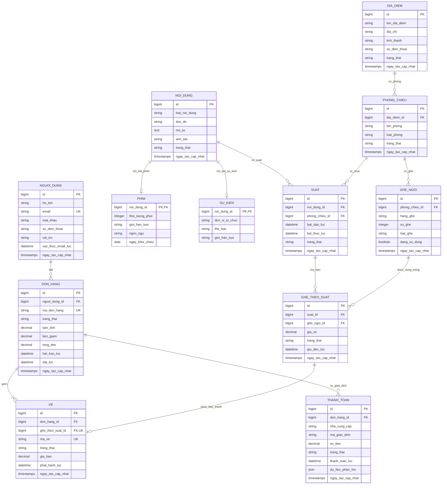

# ERD — Website dat ve phim va su kien

Ten bang, cot va quan he trong so do deu dung tieng Viet khong dau. Phim va su kien dung chung lich suat va quy trinh ban ve.

## Ý nghĩa các bảng

- `DIA_DIEM` là rạp hoặc địa điểm tổ chức; mỗi địa điểm có nhiều `PHONG_CHIEU`.
- `GHE_NGOI` là sơ đồ ghế cố định của một phòng. `hang_ghe` và `so_ghe` tạo mã dễ đọc như A01, A02.
- `NOI_DUNG` lưu thông tin chung. `loai_noi_dung` nhận `phim` hoặc `su_kien`; chi tiết riêng nằm trong `PHIM` hoặc `SU_KIEN`.
- `SUAT` là một lần chiếu phim hoặc một lần diễn ra sự kiện tại một phòng và thời điểm cụ thể.
- `GHE_THEO_SUAT` lưu giá và tình trạng của từng ghế ở từng suất. Trạng thái có thể là `trong`, `dang_giu`, `da_ban`, `tam_khoa`.
- `DON_HANG` lưu lần đặt của khách; `VE` là vé cụ thể được tạo từ ghế đã bán.
- `THANH_TOAN` lưu từng giao dịch. Một đơn có thể có nhiều bản ghi thanh toán nếu khách thử lại.

## Ràng buộc cần giữ

- `GHE_NGOI`: không trùng (`phong_chieu_id`, `hang_ghe`, `so_ghe`).
- `GHE_THEO_SUAT`: không trùng (`suat_id`, `ghe_ngoi_id`); giá vé không âm.
- `VE`: `ghe_theo_suat_id` là duy nhất để một ghế trong một suất không bị bán hai lần; `ma_ve` cũng là duy nhất.
- `SUAT`: `ket_thuc_luc` phải sau `bat_dau_luc`; không xếp hai suất bị trùng giờ trong cùng phòng.
- Khi khách chọn ghế, cập nhật `GHE_THEO_SUAT` trong transaction và đặt `giu_den_luc`. Thanh toán thành công thì chuyển sang `da_ban`; hết hạn thì mở ghế lại.
- `loai_noi_dung` chỉ nhận `phim` hoặc `su_kien`. Mỗi `NOI_DUNG` phải có đúng một bản ghi chi tiết tương ứng trong `PHIM` hoặc `SU_KIEN`.
- Dùng `DECIMAL(12,2)` cho tiền, không dùng `REAL`/`FLOAT`.

## Ghi chú Laravel

Tên bảng tiếng Việt không dấu vẫn dùng được, nhưng không khớp tên bảng mặc định Laravel. Trong từng model cần khai báo tên bảng, ví dụ `protected $table = 'nguoi_dung';`. Có thể dùng tên bảng số nhiều như trong sơ đồ nếu muốn; khi đó model cần khai báo đúng tên số nhiều ấy. Các khóa ngoại cũng nên đặt thủ công theo tên trong sơ đồ ở migration.

Mô hình hiện giả định mọi vé đều gắn với ghế đánh số. Nếu sự kiện có vé đứng hoặc vé theo khu vực, nên bổ sung bảng loại vé và sức chứa theo suất, thay vì tạo ghế giả.
